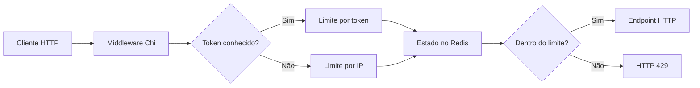

# Rate Limiter em Go com Redis

Projeto de demonstração de **middleware HTTP para limitação de requisições**, com regras por IP e por tokens conhecidos, persistência dos contadores no Redis e retorno HTTP **429 Too Many Requests** ao exceder o limite.

**Stack:** Go, Chi, Redis e Docker Compose.

> Estudo de engenharia de software. O projeto demonstra estratégias de controle de requisições, mas **não implementa ainda um rate limiter distribuído pronto para produção**.

## Componentes e fluxo



A aplicação consulta as regras no `RateLimiter`. Há dois exemplos de tokens configurados em `main.go`: `AAA` (10 requisições) e `BBB` (15 requisições). Tokens não configurados seguem o caminho de limitação por IP. Esses tokens são **identificadores de demonstração**, não credenciais seguras de autenticação.

O contador é persistido no Redis. O código atual mantém um `sync.Mutex` em memória por instância para serializar o processamento local, mas o padrão de leitura/remoção/escrita no Redis não é atômico entre réplicas.

## Executar com Docker Compose

Requer Docker e o plugin Docker Compose:

```bash
docker compose up --build
```

A aplicação ficará em `http://localhost:8080`, e o Redis usará a porta interna `6379`.

Exemplo de requisições:

```bash
curl -i http://localhost:8080/
curl -i -H 'API_KEY: AAA' http://localhost:8080/
```

Para iniciar novamente com dados descartáveis, avalie antes o impacto de remover os dados do Redis usados no seu ambiente local.

## Configuração

Use [`.env.example`](.env.example) como referência e mantenha seu `.env` fora do Git. O Compose também aceita variáveis de ambiente do terminal.

| Variável | Finalidade | Padrão do exemplo |
| --- | --- | --- |
| `WEB_SERVER_PORT` | Endereço/porta de escuta HTTP | `:8080` |
| `MAX_REQUISITIONS_BY_IP` | Limite por IP por janela | `5` |
| `BLACK_LIST_MINUTES_BY_IP` | Duração do bloqueio de IP | `2` |
| `BLACK_LIST_MINUTES_BY_TOKEN` | Duração do bloqueio de token | `2` |
| `REDIS_ADDR` | Host e porta do Redis | `localhost:6379` fora do Docker; `redis:6379` no Compose |
| `REDIS_PASSWD` | Senha do Redis, quando configurada | Vazio no ambiente demonstrativo |
| `REDIS_DB` | Índice do banco Redis | `0` |

**Atenção:** a configuração dos limites específicos de tokens está no mapa `tokenRateLimit` em `main.go`, não em variáveis de ambiente. O carregador de configuração lê variáveis e aceita um `.env` opcional.

## Qualidade

- `go vet ./...` — análise estática.
- `go build ./...` — compilação.
- `go test ./...` — testes, incluindo cenários de persistência Redis.
- [GitHub Actions](.github/workflows/ci.yml) executa as verificações acima com Redis disponível no job.

## Decisões e limitações

1. **Concorrência entre réplicas:** as operações de contagem no Redis não são atômicas entre processos. Uma evolução pode usar comandos atômicos ou script Lua com expiração.
2. **Endereço do cliente:** a extração atual do IP usa `RemoteAddr` e uma lógica de fallback para tokens curtos que pode agrupar clientes incorretamente. Deve ser corrigida e testada antes de expor atrás de proxies ou balanceadores.
3. **Segurança dos tokens:** o header `API_KEY` apenas seleciona uma regra conhecida. Não constitui autenticação ou validação de chaves.
4. **Tratamento de falhas:** erros de acesso ao Redis e política de indisponibilidade (*fail-open* / *fail-closed*) precisam de uma decisão explícita.
5. **Tempo e expiração:** a solução usa timestamps e bloqueios implementados no código. Vale avaliar TTL no Redis, precisão temporal e testes com relógio controlado.
6. **Operação:** o exemplo não demonstra métricas, tracing, testes de carga ou ambientes com múltiplas réplicas.

Esses pontos representam oportunidades de evolução do projeto, sem alegar capacidades ainda não implementadas.

## Documentação complementar

- [Configuração de segurança](SECURITY_SETUP.md)
- [Código do middleware](internal/middleware/rate_limiter_middleware.go)
- [Estratégia Redis](internal/infra/persistence/redis_strategy.go)
