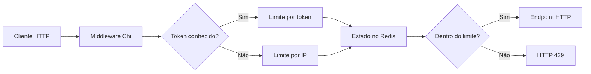

# Rate Limiter em Go com Redis

Projeto de demonstração de **middleware HTTP para limitação de requisições**, com regras por IP e por tokens conhecidos, persistência dos contadores no Redis e retorno HTTP **429 Too Many Requests** ao exceder o limite e **503 Service Unavailable** quando o Redis falha, sempre negando a requisição nessa falha.

**Stack:** Go, Chi, Redis e Docker Compose.

> Estudo de engenharia de software. O projeto demonstra estratégias de controle de requisições, mas **não implementa ainda um rate limiter distribuído pronto para produção**.

## Componentes e fluxo



A aplicação consulta as regras no `RateLimiter`. Há dois exemplos de tokens configurados em `main.go`: `AAA` (10 requisições) e `BBB` (15 requisições). Tokens não configurados seguem o caminho de limitação por IP. Esses tokens são **identificadores de demonstração**, não credenciais seguras de autenticação.

O contador agora é incrementado **atomicamente pelo Redis** usando um script Lua, com TTL na janela fixa de **1 segundo** e chave separada para bloqueio temporário. Isso mantém uma cota compartilhada mesmo quando a aplicação roda em diferentes instâncias que utilizam o mesmo Redis.

## Executar com Docker Compose

Requer Docker e o plugin Docker Compose:

```bash
docker compose up --build
```

A aplicação ficará em `http://127.0.0.1:8080`, publicada pelo Compose **apenas no loopback da máquina**. O Redis também publica a porta `6379` apenas no loopback, para uso local. Isso não substitui autenticação ou controles de rede em uma implantação real.

Exemplo de requisições:

```bash
curl -i http://localhost:8080/
curl -i -H 'API_KEY: AAA' http://localhost:8080/
```

Para iniciar novamente com dados descartáveis, avalie antes o impacto de remover os dados do Redis usados no seu ambiente local.

## Configuração

Use [`.env.example`](.env.example) como referência e mantenha seu `.env` fora do Git. O Compose também aceita variáveis de ambiente do terminal.

| Variável | Finalidade | Padrão do exemplo |
| --- | --- | --- |
| `WEB_SERVER_PORT` | Endereço/porta de escuta HTTP | `:8080` |
| `MAX_REQUISITIONS_BY_IP` | Limite por IP por janela | `5` |
| `BLACK_LIST_MINUTES_BY_IP` | Duração do bloqueio de IP | `2` |
| `BLACK_LIST_MINUTES_BY_TOKEN` | Duração do bloqueio de token | `2` |
| `REDIS_ADDR` | Host e porta do Redis | `localhost:6379` fora do Docker; `redis:6379` no Compose |
| `REDIS_PASSWD` | Senha do Redis, quando configurada | Vazio no ambiente demonstrativo |
| `REDIS_DB` | Índice do banco Redis | `0` |

**Atenção:** a configuração dos limites específicos de tokens está no mapa `tokenRateLimit` em `main.go`, não em variáveis de ambiente. O carregador de configuração lê variáveis e aceita um `.env` opcional.

## Qualidade

- `go vet ./...` — análise estática.
- `go build ./...` — compilação.
- `go test ./...` — testes, incluindo cenários de persistência Redis.
- [GitHub Actions](.github/workflows/ci.yml) executa as verificações acima com Redis disponível no job.

## Métricas e teste de concorrência

A aplicação expõe um endpoint de **diagnóstico JSON** em `http://127.0.0.1:9090/`, vinculado **somente ao loopback** do processo. Por padrão, ele não pode ser acessado diretamente de fora do contêiner. A rota não faz parte da API pública e não é instrumentada pelo rate limiter.

Exemplo de resposta (valores ilustrativos):

```json
{
  "requests_total": 100,
  "allowed_total": 5,
  "blocked_total": 95,
  "unavailable_total": 0,
  "invalid_remote_addr_total": 0,
  "duration_total_microseconds": 24000,
  "duration_buckets": {
    "le_5ms": 85,
    "le_20ms": 12,
    "le_100ms": 3,
    "le_500ms": 0,
    "gt_500ms": 0
  }
}
```

As contagens são mantidas **em memória, por instância**: não são persistidas no Redis nem agregadas entre réplicas. Os buckets de latência são faixas **exclusivas** do tempo do middleware; o total dos buckets corresponde ao total de requisições. O campo `allowed_total` significa que o rate limiter **permitiu continuar**, e não que o endpoint final respondeu com HTTP 200. A métrica `blocked_total` registra apenas rejeições por cota; `unavailable_total` registra falhas na verificação do Redis. Nessa falha, a requisição não é encaminhada (*fail-closed*) e o middleware retorna HTTP 503.

Para executar uma verificação de carga local, inicie Redis e a aplicação e execute:

```bash
python3 scripts/load_test.py --requests 400 --concurrency 20
```

O script usa somente bibliotecas padrão do Python, relata requisições por segundo, HTTP 200/429, p50/p95 e verifica coerência entre métricas e resultados. O CI executa esse cenário com Redis local e `go test -race ./...`.

**Interpretação:** isso é um teste de concorrência e regressão funcional, **não** um benchmark de capacidade de produção nem uma garantia de SLO. As medidas dependem do runner do GitHub e da configuração local. Antes de tirar conclusões de performance, realize ensaios mais longos em ambiente controlado, com carga distribuída e métricas de infraestrutura.

## Decisões e limitações

1. **Concorrência entre réplicas:** as operações de contagem e bloqueio passaram a ser atômicas via script Lua no Redis; testes exercitam dois limitadores com conexões independentes. Ainda faltam testes de carga, comportamento sob falhas de Redis e ambientes distribuídos reais.
2. **Endereço do cliente:** o middleware extrai IPv4 e IPv6 por `net.SplitHostPort`/`net.ParseIP`, sem substituir IPs por localhost para tokens curtos. **Headers `X-Forwarded-For` e `X-Real-IP` não são confiados** para impedir falsificação. Se o serviço estiver atrás de proxy ou load balancer, a limitação será pelo endereço do proxy até implementar uma cadeia explícita de proxies confiáveis.
3. **Segurança dos tokens:** o header `API_KEY` apenas seleciona uma regra conhecida. Não constitui autenticação ou validação de chaves.
4. **Tratamento de falhas:** erros do Redis (inclusive contador inválido) resultam em **fail-closed** com HTTP 503, sem encaminhar requisições. O esgotamento real da cota usa HTTP 429. A distinção também aparece nos contadores `unavailable_total` e `blocked_total`. Uma falha prolongada do Redis ainda pode tornar o serviço indisponível; circuit breakers, backoff e recuperação exigem avaliação para implantação real.
5. **Tempo e expiração:** a implementação utiliza uma **janela fixa de 1 segundo** e TTLs Redis para bloqueios. A persistência rejeita TTLs inferiores a 1 ms, que seriam truncados para zero na conversão para o script Lua. A janela não é deslizante; limites podem ser atravessados em rajadas na fronteira entre janelas.
6. **Operação:** há contadores e buckets de latência locais por instância, além de um cenário automatizado de concorrência. O servidor HTTP usa `Shutdown` com limite de 10 segundos para solicitações em andamento após SIGINT/SIGTERM. Ainda faltam tracing, métricas agregadas, ensaios de longa duração e implantação real com múltiplas réplicas. A chave de Redis tem prefixos distintos para IP/token, e o cabeçalho `API_KEY` continua sendo apenas um seletor de cota, não autenticação.

Esses pontos representam oportunidades de evolução do projeto, sem alegar capacidades ainda não implementadas.

## Documentação complementar

- [Configuração de segurança](SECURITY_SETUP.md)
- [Código do middleware](internal/middleware/rate_limiter_middleware.go)
- [Estratégia Redis](internal/infra/persistence/redis_strategy.go)
